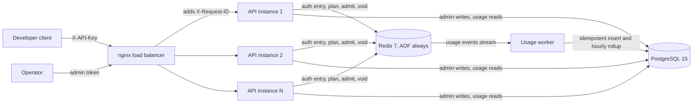
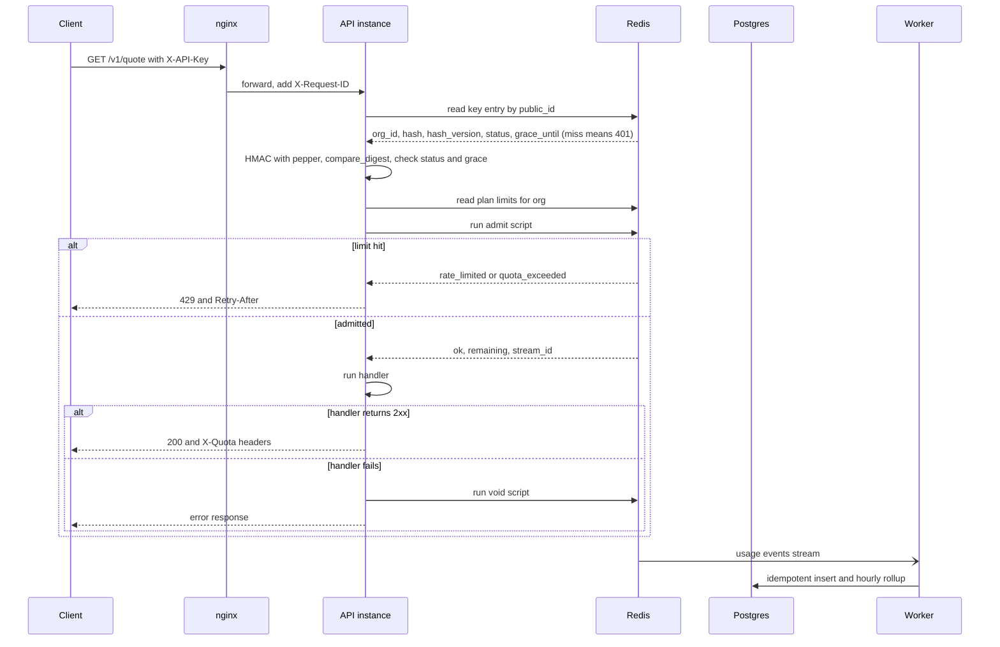
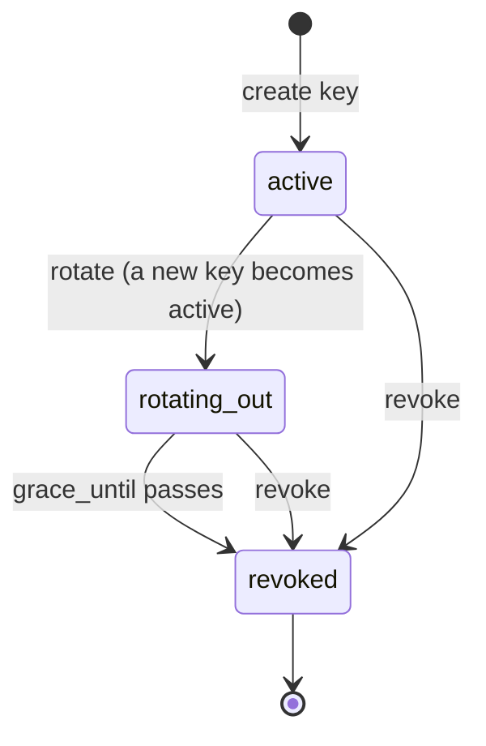
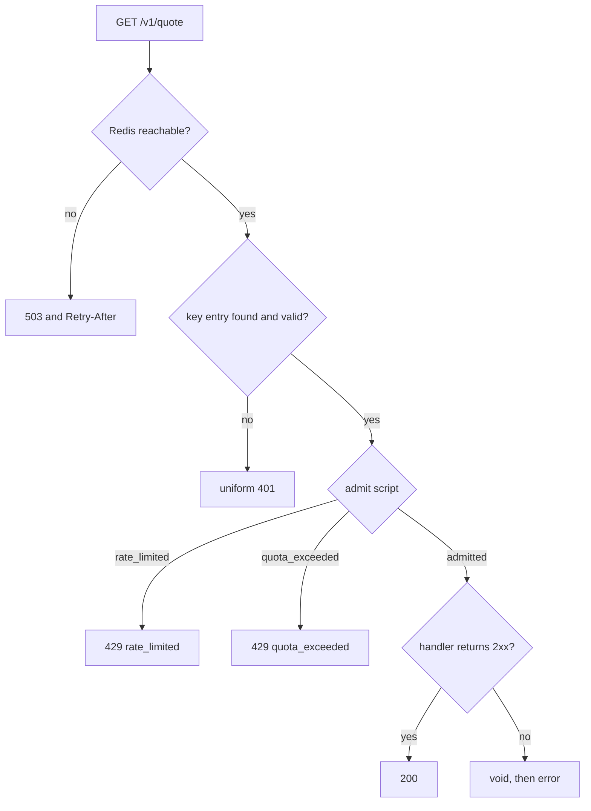

# DESIGN.md: Quota Gateway for the Quotes API

> **Status:** v2, review-ready draft for mentor review, 2026-11-20. Week 1 scope: understand, decide, design. **No feature code exists**; the only code is a throwaway limiter spike (`spike/`) and an empty application skeleton.
>
> | Document | Content |
> |---|---|
> | [OPEN_QUESTIONS.md](OPEN_QUESTIONS.md) | Silences, contradictions, questions for the client (Q-xx, C-xx) |
> | [DECISIONS.md](DECISIONS.md) | Decision table with alternatives and trade-offs (D-xx) |
> | [DATABASE_DESIGN.md](DATABASE_DESIGN.md) | Schema, constraints, indexes, retention, isolation, ER diagram |
> | [SPIKE_RESULTS.md](SPIKE_RESULTS.md) | Redis Lua limiter experiment: method, measured results, limits |
> | [THREAT_MODEL.md](THREAT_MODEL.md) | Threats T-01 to T-14 and how each guarantee will be proven |
> | [WEEK1_CHECKLIST.md](WEEK1_CHECKLIST.md) | Completion checklist and review preparation |
>
> **Honesty rule.** Client requirements (R-xx, G-x, C-x) come from the brief; everything else is our assumption and is marked so. A guarantee is called **proven** only when a passing test exists; today none does. "Spike evidence" means partial support from [SPIKE_RESULTS.md](SPIKE_RESULTS.md).

---

## 1. Project overview

A small data company sells a read-only quotes API to developers. This project is the service that controls **who** may call it and **how much**.

Operators create organizations and API keys; each organization is on a plan. Developers call `GET /v1/quote` with a key. A plan defines a short-term rate limit and a monthly allowance; going over returns a clear response saying when to retry. Operators rotate and revoke keys (rotation must not break running systems), change plans, and, like customers, see usage over time and what is left this month. The service runs as several instances behind a load balancer.

Four guarantees must be **proven**: (G-1) limits are correct with several instances, (G-2) a stolen database dump reveals no usable keys, (G-3) reported usage matches requests actually served, even across restarts and retries, (G-4) limiter overhead stays under 10 ms p95 at 200 rps.

In one sentence: *an atomic, Redis-based admission step in front of a trivial handler, with Postgres as the durable record and a worker that turns admissions into reports.*

## 2. Goals and non-goals

**Goals:** exact limits across any number of instances (G-1); no usable secret in the database (G-2); usage that never undercounts what was served and overcounts by at most what was in flight at a crash (G-3); a measured, explained latency budget (G-4); immediate, bounded-delay revocation; rotation without customer downtime; a design simple enough to explain and modify live.

**Non-goals:** billing, invoicing, overage charging; customer self-signup or any UI; managing quote data (a static dummy list is used); OAuth, JWT, named operator accounts; Redis or Postgres high availability, multi-region; volumetric DDoS protection and TLS design.

## 3. Functional requirements

| ID | Requirement | Source |
|---|---|---|
| FR-01 | Operators create organizations, each on a plan | Brief R-01 |
| FR-02 | Operators create API keys for an organization (fixed admin endpoint) | Brief R-01, C-1 |
| FR-03 | Developers call `GET /v1/quote` with a key; invalid keys are rejected | Brief R-02, C-1 |
| FR-04 | A plan enforces a short-term rate limit and a monthly allowance | Brief R-03 |
| FR-05 | Over-limit requests get a clear response with when to retry | Brief R-04 |
| FR-06 | Operators rotate keys without breaking running systems | Brief R-05 |
| FR-07 | Operators revoke keys | Brief R-05 |
| FR-08 | Customers see usage over time and remaining quota for their organization | Brief R-06, C-1 |
| FR-09 | Operators see usage for any organization | Brief R-06 |
| FR-10 | Operators change an organization's plan | Brief R-07 |
| FR-11 | Several instances run behind a load balancer | Brief R-08 |
| FR-12 | Only `GET /v1/quote` consumes rate limit and quota; `GET /usage` and admin calls do not | **Assumption** (D-03) |
| FR-13 | Every admin action is recorded in an audit log | **Assumption** (D-18) |

## 4. Non-functional requirements

| ID | Requirement | Target | Source |
|---|---|---|---|
| NFR-01 | Limiter overhead | p95 < 10 ms at 200 rps constant, protected route minus unprotected baseline | Brief G-4 |
| NFR-02 | Limit exactness | exactly L admitted when L allowed, any instance count | Brief G-1 |
| NFR-03 | Key secrecy | database dump yields no usable key | Brief G-2 |
| NFR-04 | Usage accuracy | never undercount; overcount <= in-flight at crash | Brief G-3, stated precisely by us (D-10) |
| NFR-05 | Revocation delay | <= 1 s on all instances | **Assumption** (D-09) |
| NFR-06 | Report freshness | `remaining` real time; series lag < 1 s target, alert at 30 s | **Assumption** (Q-17) |
| NFR-07 | Maintainability | ruff and mypy (strict) clean, no inline suppressions | Brief S-1 |
| NFR-08 | Reproducibility | `docker compose up` starts the system | Brief S-1 |
| NFR-09 | Availability | no SLA stated; behavior under dependency failure defined in section 18 | Brief is silent |

## 5. Assumptions

All are ours and open for confirmation.

| # | Assumption | Decision |
|---|---|---|
| A-01 | Limits are per organization, shared by its keys | D-01 |
| A-02 | A month is the UTC calendar month | D-02 |
| A-03 | Usage counts admitted requests that end 2xx; others are voided | D-03 |
| A-04 | Hard cutoff at quota; no overage; no rollover | D-04 |
| A-05 | Short-term limit is a token bucket | D-05 |
| A-06 | Plan changes apply immediately; no reset or proration | D-13 |
| A-07 | Rotation grace is 24 h by default | D-08 |
| A-08 | Redis down means fail closed | D-12 |
| A-09 | Hourly granularity; raw events 14 days, rollup 13 months | D-15 |
| A-10 | One static admin token | D-18 |
| A-11 | Scale: 1,000 orgs, 10,000 keys, 200 rps peak, 2 to 4 instances | Q-25 |
| A-12 | Instances are reachable only through the load balancer | D-14 |

## 6. Open questions

Full list with defaults: [OPEN_QUESTIONS.md](OPEN_QUESTIONS.md). Those that change the design if answered differently:

| ID | Question | Default applied |
|---|---|---|
| Q-01 | Per-key or per-organization limits? | Per organization |
| Q-03 | What exactly is a "served" request? | Admitted and 2xx |
| Q-05 | Timezone or anchor for "month"? | UTC calendar month |
| Q-08 | Plan change mid-month: reset, prorate, neither? | Neither, immediate |
| Q-11 | Is a lost key recoverable? | No; rotate |
| Q-15 | Acceptable revocation delay? | <= 1 s |
| Q-19 | Bounded difference after a crash acceptable? | Never undercount; overcount <= in-flight |
| Q-21 | Redis down: fail open or closed? | Closed |
| Q-28 | Instances reachable only through the LB? | Yes |

## 7. Technical decision table

Summary only; reasons, alternatives and trade-offs are in [DECISIONS.md](DECISIONS.md).

| ID | Decision | Selected approach |
|---|---|---|
| D-01 | Limit scope | Per organization |
| D-02 | Monthly window | UTC calendar month |
| D-03 | What counts | Admitted and 2xx; else voided |
| D-04 | Quota exhaustion | Hard cutoff |
| D-05 | Short-term limiter | Token bucket |
| D-06 | Atomicity | Redis, one Lua script |
| D-07 | Key storage | HMAC-SHA256 plus pepper, shown once |
| D-08 | Rotation | Grace window, `active` keys only |
| D-09 | Revocation | Immediate, Redis auth state, no per-instance cache |
| D-10 | Usage pipeline | Event inside admission, stream, worker, Postgres |
| D-11 | Redis durability | AOF `always`, `noeviction`, rebuild after wipe |
| D-12 | Redis down | Fail closed |
| D-13 | Plan change | Immediate, no reset |
| D-14 | Duplicates | LB request-id marker; ignore client keys |
| D-15 | Granularity, retention | Hourly; 14 days raw, 13 months rollup |
| D-16 | `GET /usage` access | Own org by key, or admin plus `org_id` |
| D-17 | Over-limit response | 429, two codes, `Retry-After` |
| D-18 | Admin auth | Static token |
| D-19 | Time source | Redis `TIME`; app clock for month label |
| D-20 | Topology | nginx, N instances, one Redis, one Postgres, worker |
| D-21 | Isolation | `org_id` everywhere, enforced in data access |
| D-22 | Identifiers | UUIDs, random `public_id` |
| D-23 | Quote data | Static list |

## 8. Rejected alternatives

| Alternative | Rejected because | Decision |
|---|---|---|
| Fixed-window counter | Up to 2x burst at window edges | D-05 |
| Sliding-window log | Memory grows with request rate | D-05 |
| Naive `GET` then `INCR` | Not atomic: admitted 106 to 125 against a limit of 100 in the spike | D-06 |
| `WATCH`/`MULTI` | Retries under contention; the script is simpler and atomic | D-06 |
| Postgres-only counters | Hot-row contention, too slow | D-06 |
| Per-instance in-memory limits | Wrong with several instances | D-06 |
| bcrypt/argon2 for keys | Slow by design, useless for 256-bit secrets, blows the budget | D-07 |
| Reversible encryption of keys | A dump plus the encryption key reveals keys | D-07 |
| JWT as API keys | Cannot be revoked instantly | D-07, D-09 |
| Per-instance key cache | Revocation delay equals the cache TTL | D-09 |
| Emit usage event after serving | A crash in between undercounts | D-10 |
| Synchronous Postgres write per request | Database in the hot path | D-10 |
| Redis `everysec` AOF | Can lose acknowledged writes on power loss | D-11 |
| Fail open when Redis is down | Unmetered access; breaks G-1 and G-3 | D-12 |
| Trusting a client `Idempotency-Key` | A client could reuse one key and never consume quota (found in self-review) | D-14 |
| Raw usage kept 90 days | About 1.5 billion rows at the 200 rps peak | D-15 |
| Postgres row-level security | Per-request session state on pooled connections | D-21 |
| Redis Cluster / Sentinel | Beyond project scope; listed as limitation | D-20 |

## 9. System architecture



| Component | Responsibility | State |
|---|---|---|
| nginx | Distribute traffic; assign a unique `X-Request-ID` (overwriting any client value); retry a failed GET on another instance | none |
| API instance (FastAPI) | Authenticate, run the limiter, serve the quote, admin and usage endpoints | none |
| Redis | Auth entries, plan limits, token buckets, monthly counters, request markers, usage stream | derived, rebuildable (D-11) |
| Worker | Stream to Postgres idempotently; hourly rollup; retention and reconcile jobs | none |
| Postgres | Source of truth: plans, organizations, keys, usage, audit | durable |

**Principle:** instances are interchangeable and stateless; all shared state is in Redis or Postgres.

**Repository layout (matches the skeleton):** `app/` (empty app plus empty packages `auth/ limiter/ usage/ admin/ quotes/ db/`), `tests/`, `perf/`, `spike/`, `nginx/nginx.conf`, `docker-compose.yml`, `Dockerfile`, `.github/workflows/ci.yml`.

## 10. Database design

Full detail: [DATABASE_DESIGN.md](DATABASE_DESIGN.md) (ER diagram, DDL sketch, constraints, indexes, retention, isolation).

| Table | Purpose | Key constraints |
|---|---|---|
| `plans` | Rate, burst, monthly quota | unique `name`, positive checks |
| `organizations` | Customer and its plan | unique `name`, FK to plans (RESTRICT) |
| `api_keys` | `public_id`, `key_hash`, `hash_version`, `status`, `grace_until`, `replaced_by` | unique `public_id`; no plaintext column; status checks |
| `usage_events` | One row per admitted request | primary key `stream_id` (idempotent worker insert) |
| `usage_hourly` | Rollup for reports and counter rebuild | primary key `(org_id, hour)` |
| `audit_log` | Admin actions | append-only grants |

## 11. API endpoint sketch

| Endpoint | Auth | Purpose |
|---|---|---|
| `GET /v1/quote` | API key | The protected quote (fixed by contract) |
| `GET /usage` | API key or admin token | Usage and remaining quota (fixed by contract) |
| `POST /admin/orgs` | Admin | Create an organization with a plan |
| `POST /admin/orgs/{org_id}/keys` | Admin | Create a key (the fixed admin endpoint) |
| `POST /admin/keys/{key_id}/rotate` | Admin | Issue a replacement; old key enters grace |
| `POST /admin/keys/{key_id}/revoke` | Admin | Revoke immediately |
| `PUT /admin/orgs/{org_id}/plan` | Admin | Change plan |
| `GET /healthz` | none | Liveness (exists in the skeleton) |
| `GET /readyz` | none | Readiness: Redis reachable, epoch present (later) |

Customer header: `X-API-Key: qk_<public_id>_<secret>`. Admin header: `Authorization: Bearer <admin token>`.

**Create key** returns `201` once, with the only copy of the key:

```json
{ "key_id": "5b1f…", "api_key": "qk_Zk3pQ9_…", "org_id": "9c2e…", "status": "active" }
```

**Successful quote** (`200`) carries `X-Quota-Limit`, `X-Quota-Remaining`, `X-Quota-Reset` for the monthly allowance.

**Rejected, short-term** (`429`, header `Retry-After: 2`):

```json
{ "error": "rate_limited", "message": "Too many requests. Retry in 2 seconds.",
  "retry_after_seconds": 2, "limit": 10, "remaining": 0, "reset_at": "2026-11-20T10:00:02Z" }
```

**Rejected, monthly** (`429`, `Retry-After` = seconds to 00:00 UTC on the first of next month):

```json
{ "error": "quota_exceeded", "message": "Monthly allowance used. Resets at the start of next month (UTC).",
  "retry_after_seconds": 936000, "limit": 100000, "remaining": 0, "reset_at": "2026-12-01T00:00:00Z" }
```

**Usage** `GET /usage?from=2026-11-20T00:00:00Z&to=2026-11-21T00:00:00Z&granularity=hour`:

```json
{ "org_id": "9c2e…", "plan": "pro",
  "period": { "start": "2026-11-01T00:00:00Z", "end": "2026-12-01T00:00:00Z" },
  "quota": 100000, "used": 4210, "remaining": 95790, "granularity": "hour",
  "series": [ { "start": "2026-11-20T09:00:00Z", "count": 312 } ],
  "as_of": "2026-11-20T09:41:07Z" }
```

`used`/`remaining` come from the Redis counter (current); `series` from Postgres may lag, hence `as_of`.

Status codes: `401` unknown, revoked or expired keys with an **identical body**; `403` wrong credential type; `409` rotating a key that is not `active`; `429` limits; `503` Redis unavailable (with `Retry-After`).

## 12. Authentication flow



1. Parse `qk_<public_id>_<secret>`; a malformed key gets the uniform 401.
2. Look up `key:<public_id>` in Redis. **A miss is a 401**; Postgres is never queried on the request path (D-09, T-13).
3. Compute `HMAC-SHA256(pepper[hash_version], secret)`; compare with `hmac.compare_digest`; mismatch is the uniform 401.
4. `active` passes; `rotating_out` passes only while `now < grace_until`; anything else is 401.
5. Load plan limits, then run `admit` (section 13). Identical on every instance.
6. Admin routes use a separate static bearer token (constant-time compare); an API key is not accepted there.

## 13. Rate-limiting strategy

**Token bucket per organization (D-05).** The bucket holds up to `burst` tokens and refills at `rate_per_sec`; each admitted request takes one. Time comes from Redis `TIME` (D-19), and elapsed time is clamped at zero so a backwards clock step cannot create tokens.

**Illustrative plans (assumed values, not from the brief):**

| Plan | Rate | Burst | Monthly quota |
|---|---|---|---|
| free | 2 / s | 5 | 1,000 |
| pro | 20 / s | 40 | 100,000 |
| business | 100 / s | 200 | 3,000,000 |

**Admission is one Lua script** (D-06), in order: replay check (marker for this request id: `admit` means replay, allow and consume nothing; `void` means fresh attempt); monthly counter check; bucket refill; if tokens < 1 reject `rate_limited` with the wait; otherwise take a token, `INCR` the counter, set the marker, `XADD` the usage event; return `(allowed, reason, remaining, retry_after_ms, stream_id)`. A rejection changes **nothing**. The quota check precedes the bucket check so an exhausted organization is never charged a token.

**Retry-After:** `rate_limited`: `ceil((1 - tokens) / rate)` seconds, minimum 1. `quota_exceeded`: seconds to the next UTC month.

**Evidence so far** ([SPIKE_RESULTS.md](SPIKE_RESULTS.md)): exact counts in all scenarios including 4 processes; refill within 1 token of expectation over 3 to 5 s; a naive limiter overshot in every run. Not yet shown: behavior through HTTP with real instances.

## 14. Monthly quota management

- **Counter:** Redis integer `{org:<id>}:q:<YYYYMM>`; month label from the instance's UTC clock (D-19); TTL = seconds to month end plus 7 days. A new month is a new key, so there is **no reset job**.
- **Check and increment** run in the same script as the bucket, so quota and rate cannot disagree.
- **Void:** a handler failure runs `void`, which decrements once (guarded by an `NX` key) and appends a `void` event, so the counter equals admitted-and-not-voided requests.
- **Plan change:** the next admission reads the new limits; the counter is untouched (D-13). A downgrade below current usage yields `quota_exceeded` until the next month.
- **Reconcile job (worker):** every few minutes compare each active organization's counter with `SUM(usage_hourly)` for the month plus unprocessed stream entries; drift beyond a small tolerance alerts and is corrected. Counter reads are clamped at zero.
- **Rebuild:** after data loss (missing `meta:epoch`) counters are rebuilt from `SUM(usage_hourly)` before the service reports ready (D-11).
- **Month boundary:** a request within the NTP skew of 00:00 UTC on the first can land in the adjacent counter; bounded to milliseconds of traffic.

## 15. API key rotation and revocation



- **Create:** generate `public_id` and a 256-bit secret; store only the HMAC; return the full key once; write the Redis entry and an audit row.
- **Rotate** (`active` only, else 409): one transaction with a row lock creates the replacement `active`, sets the old key `rotating_out` with `grace_until = now + grace` (default 24 h, max 7 days) and `replaced_by`. Both keys share the organization's limits. Postgres first, then Redis write-through.
- **Grace expiry:** checked on every request via `grace_until`, so it is exact without a timer; a sweep later marks `revoked` and removes the Redis entry.
- **Revoke:** Postgres transaction, then removal from Redis in the same request; if the Redis step fails the request returns 500 and the operator retries (idempotent). No per-instance cache, so the next request on any instance is rejected (target <= 1 s).
- **Concurrency:** two simultaneous rotations of one key: the row lock lets one win (201), the other gets 409.
- **Pepper rotation:** `hash_version` says which pepper verifies a key; new keys use the newest (T-12).

## 16. Usage tracking and reporting

**Pipeline (D-10):** admit (atomic, durable) -> serve -> stream -> worker -> Postgres.

1. `admit` appends an `admit` event to the stream `usage:events` **inside** the atomic step that increments the counter, so an admitted request always has a recorded event, even if the instance dies immediately.
2. The worker reads through a consumer group and, in **one Postgres transaction**: inserts `ON CONFLICT (stream_id) DO NOTHING RETURNING ...`; increments `usage_hourly` only for rows actually inserted; for `void` events sets `voided_at` on the matching admit row (`WHERE voided_at IS NULL RETURNING ...`) and decrements that hour; commits; then `XACK`s.
3. A crashed worker leaves entries pending; another reclaims them with `XAUTOCLAIM` after an idle timeout. Redelivery is harmless.
4. Retention jobs delete raw events older than 14 days and hourly rows older than 13 months.

**Precise guarantee (G-3):** at-least-once delivery plus an idempotent write gives an exactly-once effect in Postgres. End to end, usage **never undercounts** requests that returned 2xx and **can overcount by at most the requests in flight** when an instance died. A client retry that is served counts as a separate request (D-14, Q-19); only infrastructure duplicates are removed.

**Reporting:** `GET /usage` returns `used`/`remaining` from the Redis counter and the hour or day series from `usage_hourly` (days summed from hours, UTC). Customers see only the organization of their key; the admin token plus `org_id` sees any (D-16, D-21).

## 17. Multi-instance architecture

- Any number of identical, stateless instances behind nginx; no sticky sessions, local counters, or local caches.
- All limit state lives in Redis and changes through one atomic script (spike: exact across 4 processes). Bucket timing uses Redis `TIME`.
- nginx assigns `X-Request-ID` and may retry a failed GET on another instance; the marker in `admit` makes that retry a replay, not a second charge (D-14).
- **Trust assumption:** instances must be reachable **only** through nginx, because a client able to choose its own `X-Request-ID` could reuse an id to bypass quota. In Compose the instances publish no ports (A-12).
- Workers scale horizontally through the consumer group.
- **Single points of failure:** one Redis, one Postgres (D-20), stated in section 22.

## 18. Failure modes and recovery



| Failure | User-visible effect | Behavior and recovery | Residual risk |
|---|---|---|---|
| Redis down or unreachable | Protected route returns 503 | Fail closed (D-12); short timeouts; resumes when Redis returns | Total outage of the protected route; no replica |
| Redis restart, files intact | Brief 503 | AOF `always` restores counters, buckets, stream; counter >= acknowledged (spike 4.6, process kill only) | Power-loss durability not independently verified |
| Redis data lost | Not ready until rebuilt | Missing `meta:epoch`: rebuild counters from `usage_hourly`, reload keys and plans, then ready | Events not yet flushed (<= worker lag) lost |
| Redis memory full | Admission fails, so 503 | `noeviction` rejects writes instead of deleting data; alert at 50% of `maxmemory` | Outage until space is freed |
| Postgres down | Admin calls and key creation fail; metered traffic continues | Request path uses Redis only; stream buffers; worker retries and catches up | Long outage can exhaust Redis memory |
| Worker down or lagging | `series` in `/usage` stale | `as_of` shows it; lag alert; consumer group resumes with no loss | Reports trail reality |
| Instance crash mid-request | Client may see a connection error | LB retries a GET on another instance; marker prevents double count | At most in-flight requests overcounted |
| Duplicate stream delivery | None | Idempotent insert on `stream_id`; rollup only for inserted rows | None known |
| Redis write-through fails after Postgres commit | Admin call returns 500 | Operator retries (idempotent); reconcile job repairs Redis auth and plan entries | Short window where Redis lags Postgres |
| Clock skew between instances | None for limits | Bucket uses Redis `TIME` | Month label wrong within milliseconds of the boundary |
| Admin token or pepper leak | See T-11, T-12 | Rotation procedures | Single shared admin token |

## 19. Security considerations

| Topic | Design |
|---|---|
| Key generation | 256 random bits via `secrets.token_urlsafe(32)`; `qk_<public_id>_<secret>` |
| Key storage | `HMAC-SHA256(pepper, secret)` only; pepper outside the database; `hash_version` for rotation; no plaintext column (G-2, T-01) |
| One-time disclosure | The full key appears only in the create and rotate responses |
| Comparison | `hmac.compare_digest`; identical 401 for unknown, wrong, revoked, expired keys (T-13) |
| Revocation | Immediate, Redis write-through, no per-instance cache (T-02) |
| Request-path isolation | Redis-only lookups; an invalid-key flood never reaches Postgres |
| Admin access | Static token, constant-time compare, audited; restrict admin routes to an internal network at the LB (T-11) |
| Tenant isolation | `org_id` on every row; the customer's organization comes from the key, never a parameter (D-21) |
| Logging | `X-API-Key` and admin token redacted; no secrets in `audit_log` (T-14) |
| Config secrets | `.env.example` has placeholders only; real values come from the environment |
| Duplicate trust | `X-Request-ID` trusted only because instances are not directly reachable (A-12) |
| Transport | TLS terminates at the load balancer (out of scope) |

## 20. Testing strategy

**Rule:** a guarantee is claimed only when its test passes. Tests are written from Week 2; this table is the contract. Layers: unit (hashing, retry-after math), integration with `docker compose`, chaos (kill an instance, Redis or Postgres under load), performance (k6).

| Guarantee | Test | Method / pass criterion | Status |
|---|---|---|---|
| G-1 | `test_multi_instance_limits` | >= 3 instances behind nginx; 10x L concurrent requests for allowance L; exactly L succeed; repeat 20 times | Planned (spike evidence at Redis level) |
| G-2 | `test_db_dump_no_usable_keys` | Dump all tables; no secret present; every stored value tried as a key gives 401; different pepper gives different hash | Planned |
| G-3 | `test_usage_matches_served` | Constant load; `kill -9` an instance; Postgres count >= client 2xx and <= client 2xx + in-flight | Planned |
| G-3 | `test_redis_restart_no_usage_loss` | Kill and restart Redis under load; counters and Postgres match client-observed admissions | Planned (spike 4.6 partial) |
| G-3 | `test_redis_wipe_rebuild` | Delete Redis data; ready only after counters equal Postgres | Planned |
| G-3 | `test_lb_retry_counted_once` | Same request id on two instances counts once | Planned (spike 4.5) |
| G-3 | `test_duplicate_request_id_counted_once` | Concurrent same id: one admission | Planned (spike 4.5) |
| G-3 | `test_worker_redelivery_idempotent` | Same batch twice changes nothing | Planned |
| G-3 | `test_void_idempotent` | Void twice decrements once | Planned |
| G-3 | `test_client_idempotency_key_ignored` | 100 requests with one `Idempotency-Key` all counted | Planned |
| G-4 | `perf/k6_200rps.js` | Constant 200 rps; protected minus baseline p95 < 10 ms; before/after | Planned |
| R-05 | `test_rotation_no_downtime` | Zero failures during rotation; old key 401 after grace | Planned |
| R-05 | `test_concurrent_rotate_one_wins` | Two rotates: one 201, one 409 | Planned |
| T-02 | `test_revocation_immediate` | Next request on every instance is 401; <= 1 s | Planned |
| T-05 | `test_rate_limit_retry_storm` | Admitted <= burst + rate x duration; `Retry-After` accurate | Planned |
| T-08 | `test_postgres_outage_buffering` | Warm-key traffic continues; no loss after recovery | Planned |
| T-09 | `test_redis_down_fails_closed` | All 503, none 200, usage unchanged | Planned |
| T-11 | `test_admin_endpoints_require_token` | Every admin route rejects missing or wrong token | Planned |
| T-12 | `test_pepper_version_rotation` | Old keys verify under their version; new keys use the new one | Planned |
| T-13 | `test_uniform_401`, `test_invalid_key_flood_no_db_queries` | Identical responses; zero Postgres queries | Planned |
| T-14 | `test_logs_redact_keys` | No key in captured logs | Planned |
| R-06, R-07 | `test_usage_isolation`, `test_plan_change_immediate`, `test_quota_exceeded_retry_after` | Isolation, immediate plan effect, correct `Retry-After` | Planned |

**CI** (`.github/workflows/ci.yml`): ruff check, ruff format check, mypy, pytest on every push; integration and chaos tests join as service containers when they exist.

**Evidence today:** the spike and a passing empty-app check (`ruff`, `mypy --strict`, `pytest`).

## 21. Performance validation strategy

**Target (G-4):** limiter overhead < 10 ms p95 at 200 rps constant. **Definition (C-05):** p95 of `GET /v1/quote` minus p95 of an unprotected baseline route (same handler, no auth or limiter) under identical conditions.

1. **Naive first.** Build the straightforward version.
2. **Measure.** k6, constant arrival rate 200 rps, several minutes, through nginx with 2 instances, warm-up excluded; record p50/p95/p99, errors, CPU on app, Redis, Postgres. Save to `perf/results/before.md`.
3. **Profile.** Find the real bottleneck rather than guessing.
4. **Fix exactly one thing**, re-measure identically, save `perf/results/after.md`, explain the delta.

**Hypotheses to test (not conclusions):** the number of Redis round trips on the request path (key entry, plan, admit; reading the plan inside the admit script would remove one); event-loop blocking from a synchronous client; HMAC cost (expected negligible); connection pool sizing; the nginx-to-instance connection (the app logs show nginx proxying with `HTTP/1.0`, which opens a new TCP connection for every request; `proxy_http_version 1.1` with an upstream `keepalive` pool is a cheap candidate fix); the write latency of `appendfsync always` (spike: p50 about 4x higher on the reference machine and about 7x on the student's, where one call reached p95 2.6 ms and p99 5.0 ms; the leading candidate for the real bottleneck).

**What exists today:** only the Redis-level timing in the spike (admit p50 0.056 ms, p95 0.086 ms without AOF; p50 0.229 ms, p95 0.510 ms with AOF `always`; loopback, 1 vCPU sandbox). On the student's machine (Docker Desktop VM, Redis 8.0.2) the same call measured p50 0.135 ms / p95 0.291 ms without AOF and p50 0.888 ms / p95 2.603 ms with AOF `always`. This is **not** the G-4 measurement.

## 22. Known limitations (and readiness for change)

These feed `LIMITATIONS.md` (a later deliverable).

| Limitation | Effect |
|---|---|
| Single Redis, single Postgres | Either failing degrades service (Redis: total outage of the protected route) |
| Fail closed on Redis loss | Availability sacrificed for control |
| Overcount on instance crash | Up to the in-flight requests at the crash |
| Loss window after total Redis disk loss | Events not yet flushed (<= worker lag) |
| `appendfsync always` latency | One Redis call reached p95 2.6 ms and p99 5.0 ms on the student's machine; may threaten G-4. Fallback `everysec` loses up to about a second on power loss |
| Process-kill test cannot show fsync durability | Power-loss behavior of `appendfsync always` is Redis's documented behavior, not verified here |
| Single static admin token | No per-operator accountability; a leak is full control |
| No per-IP throttle, no anomaly detection | Floods and stolen-key abuse limited only by plan limits until noticed |
| Month label from the application clock | Milliseconds of misattributed traffic at month boundaries |
| `X-Request-ID` trust | Safe only while instances are unreachable except through nginx |
| `usage_events` unpartitioned | Fine at the assumed average; sustained 200 rps needs daily partitions |
| Spike is Redis-level only | G-1 through HTTP, G-3 end to end, G-4 not yet evidenced |
| Compose verified only on one machine | The stack starts on the student's Windows/Docker Desktop setup (2026-11-21), nginx balances evenly across both instances, Redis runs with `appendfsync always` and `noeviction`, and the instances are not reachable directly; not tested on other machines or in CI |

**Readiness for the expected mid-month change (C-08).** Plan limits are data; the limiter is generic over a scope key and window; usage is stored hourly.

| Likely change | What it touches |
|---|---|
| Per-key limits instead of per-organization | scope key in the limiter wrapper, a per-key limits source, auth dependency, `test_multi_instance_limits` |
| New plan tier | a `plans` row (data migration); no code |
| Rolling 30-day window | `admit` script (counter becomes buckets or a sorted set), `Retry-After`, reconcile job |
| Overage allowed | soft-limit flag in `admit`, plan column, usage reporting |

---

## Appendix A. Self-review log (Day 6)

Reviewed as a strict reviewer would. Weaknesses found and what changed:

| # | Weakness | Area | Resolution |
|---|---|---|---|
| 1 | The earlier draft trusted a client `Idempotency-Key` to avoid double counting; a client could send one key forever, use the API free, and bypass the quota | Security, accounting | Marker on a **load-balancer-assigned** request id; client keys ignored (D-14, T-06) |
| 2 | An unknown key fell back to a Postgres lookup, so an invalid-key flood could load the database | Security, scalability | Redis holds every usable key; a miss is a 401 with no database access (D-09, T-13) |
| 3 | No way to rotate the pepper without invalidating every key | Security | `api_keys.hash_version` (D-07, T-12) |
| 4 | "Usage matches served" was unprovable: recording after serving leaves a crash window | Accounting | Event written inside admission; guarantee restated precisely (D-10) |
| 5 | A globally unique `request_id` would let reused ids drop usage rows | DB consistency | Row identity is the Redis `stream_id`; `request_id` informational |
| 6 | A Redis restart could silently reset counters; durability settings were unnamed | Reliability | AOF `always`, `noeviction`, epoch rebuild (D-11); spike 4.6 shows why AOF is needed |
| 7 | 90-day raw retention implied about 1.5 billion rows at the 200 rps peak | Scalability | 14 days raw, 13 months rollup; counters rebuilt from the rollup; sizing and partition path (D-15) |
| 8 | Two concurrent rotations of one key could create two replacements | Race condition | Row lock, `active`-only rotation, 409 (D-08) |
| 9 | Redis write-through can fail after a Postgres commit, leaving Redis stale | Consistency | Operator retry (idempotent) plus a reconcile job |
| 10 | After a Redis wipe a void of a pre-wipe admission could drive a counter negative | Correctness | Reads clamped at zero; reconcile corrects drift |
| 11 | `X-RateLimit-*` headers were ambiguous between rate and quota | API clarity | Success responses carry `X-Quota-*`; the 429 body describes the limit that triggered |
| 12 | "Redis `TIME` decides the month" over-claimed (Lua cannot format dates) | Correctness | Month label from the app clock, documented as residual risk (D-19) |
| 13 | Three Redis round trips per request may threaten the 10 ms budget | Performance | Listed as the first hypothesis to measure; not changed blindly |
| 14 | De-duplication depends on instances being unreachable except through nginx | Security | Assumption A-12, Compose publishes no app ports, listed as a limitation |

**Not fixed (accepted and documented):** single Redis and Postgres, single admin token, no per-IP throttle, no anomaly detection, unpartitioned `usage_events`, fsync durability not independently verified, spike limited to the Redis level.

## Appendix B. What is and is not proven today

| Claim | State |
|---|---|
| A read-then-write limiter races; the script does not | **Measured** in the spike (10 of 10 naive runs overshot; 0 Lua overshoots) |
| Limits exact across processes at the Redis level | **Measured** in the spike |
| Concurrent duplicate request ids admit once | **Measured** in the spike (200 of 200 rounds) |
| Persistence off loses everything; `always` loses nothing on a process kill | **Measured** in the spike (not power loss) |
| G-1 through HTTP, G-2, G-3 end to end, G-4 | **Not yet proven**; tests planned in section 20 |
| Compose stack starts with `docker compose up` | **Verified on the student's machine, 2026-11-21:** all five services start, health checks pass, requests through nginx succeed and split 5/5 across `app1` and `app2`, Redis settings are as designed, instances are unreachable directly |