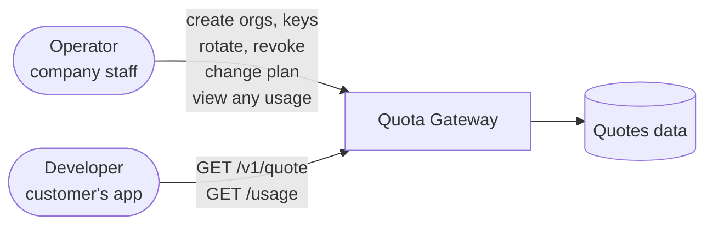
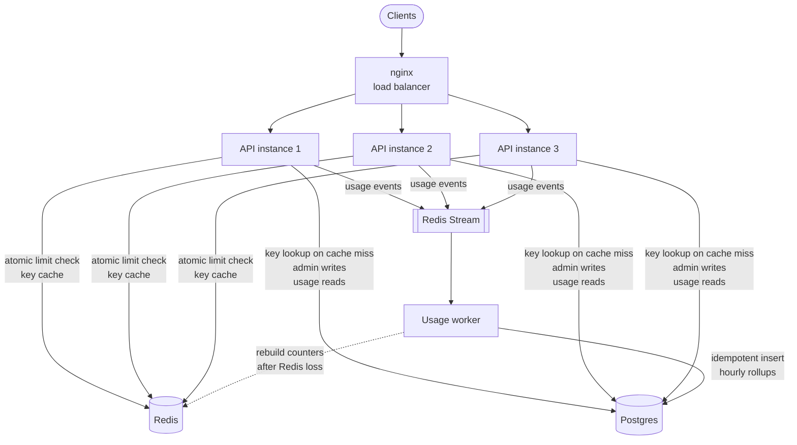
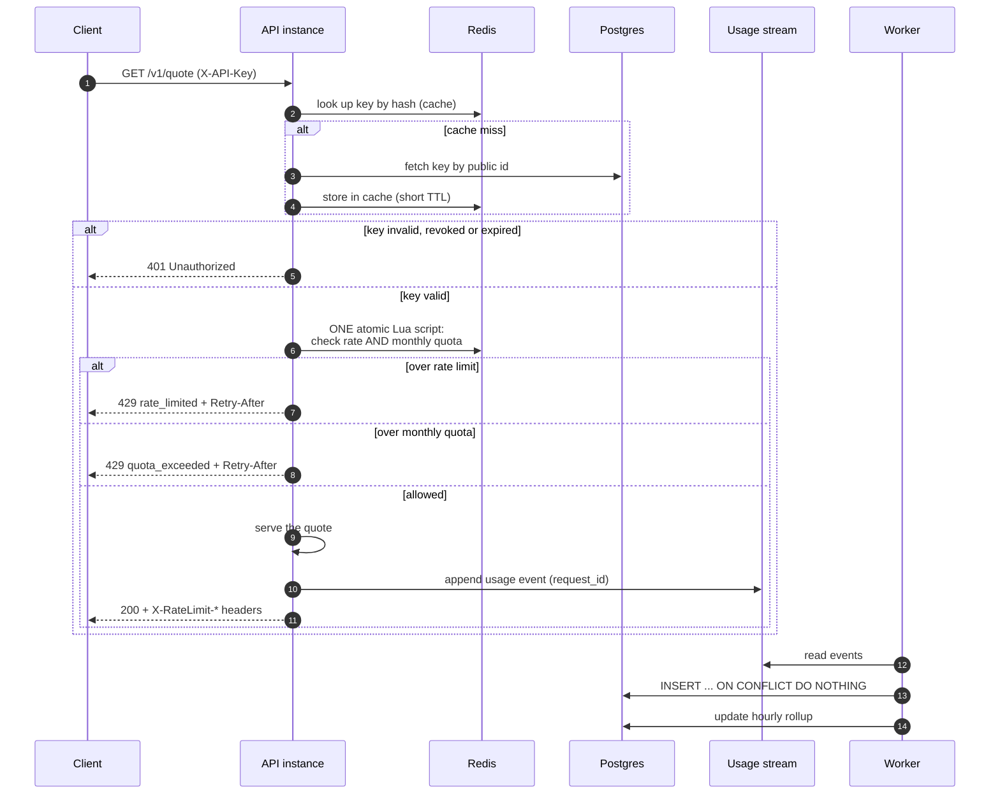
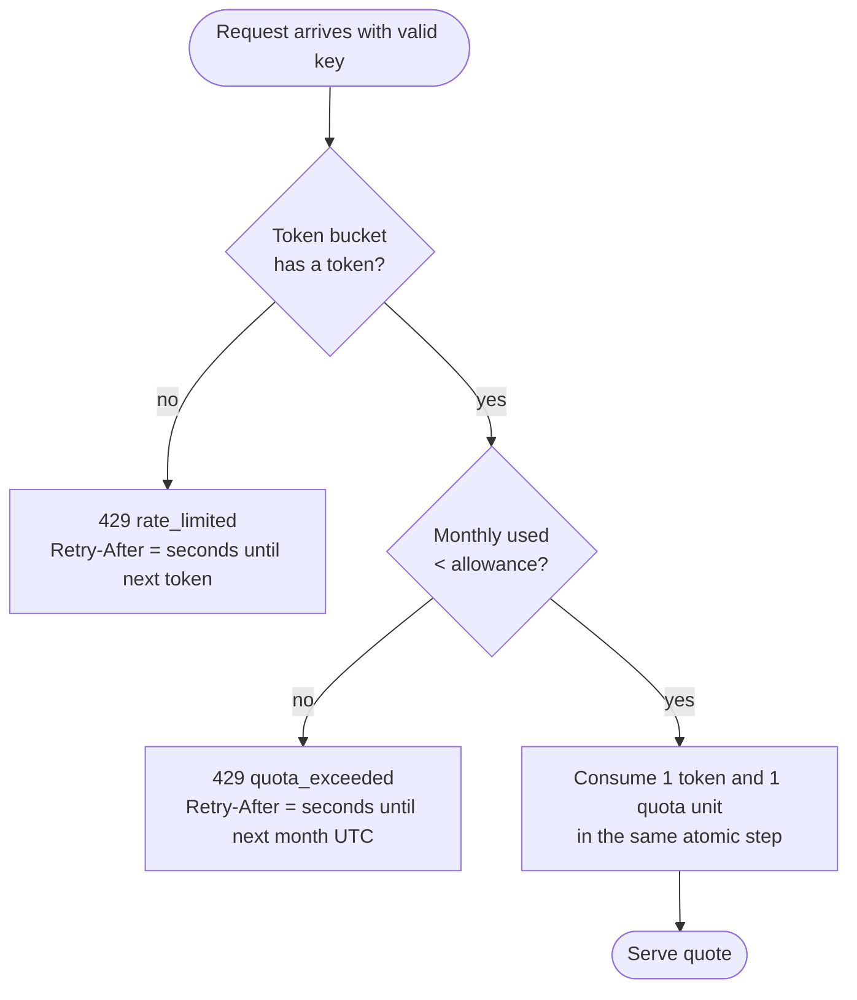
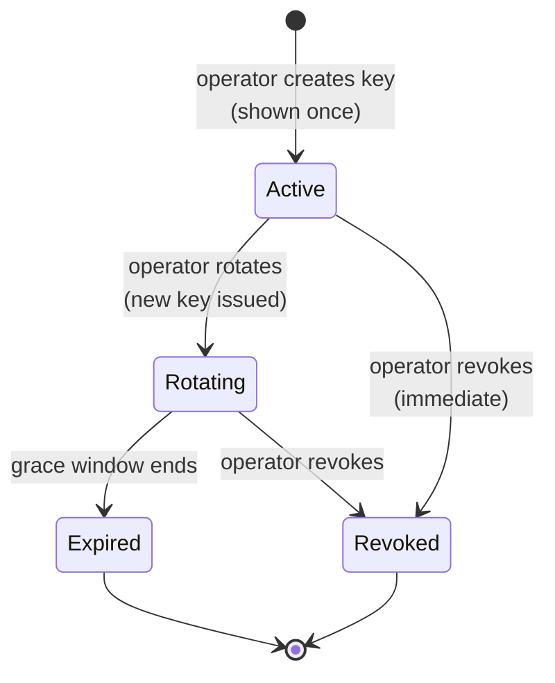
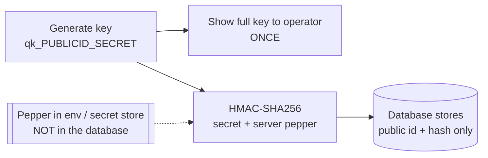
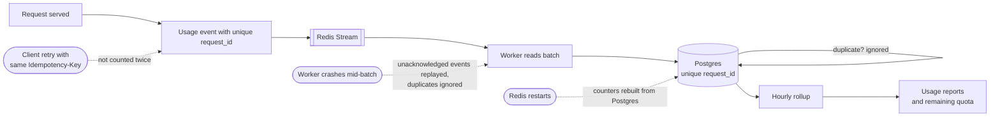
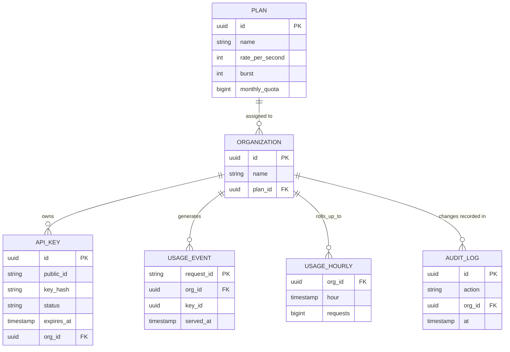
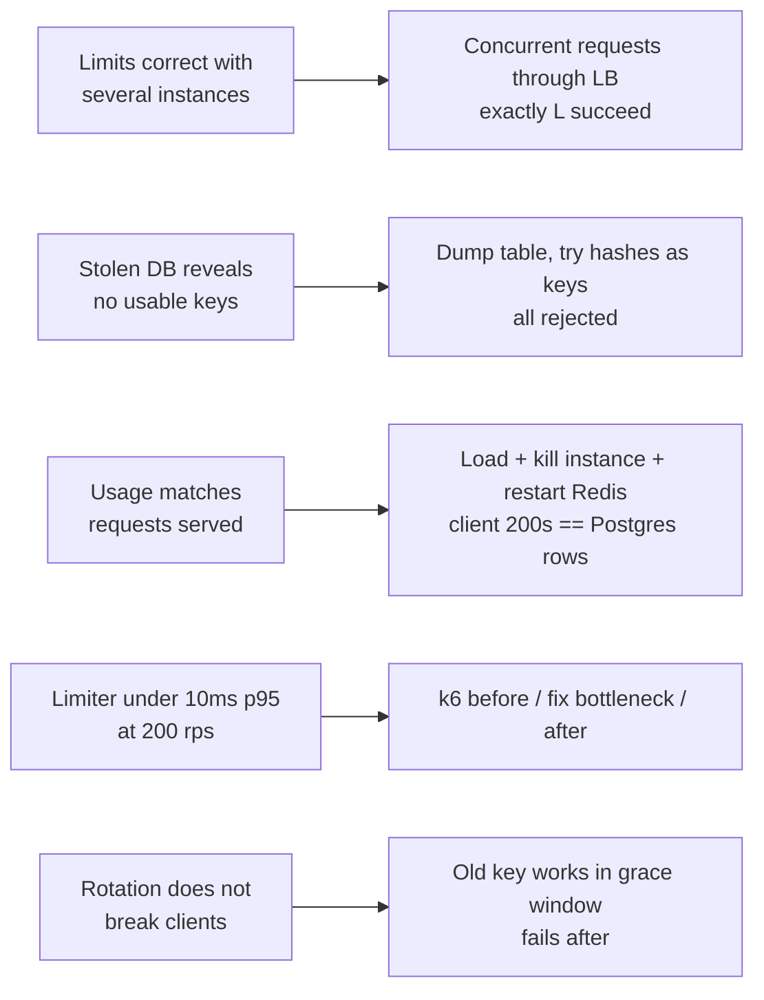

# Project Overview: Quota Gateway for the Quotes API

> A plain-language guide to what we are building. Diagrams use Mermaid (they render on GitHub, VS Code with a Mermaid extension, and most Markdown viewers).

---

## 1. The one-minute version

A small company sells **quotes data** through a **read-only API**. They need a **gatekeeper** in front of it that decides:

- **Who** may call it (API keys that belong to organizations)
- **How fast** they may call it (short-term rate limit)
- **How much** they may call it (monthly allowance)
- **What happened** (usage reports for the company and for customers)

The quotes themselves are dummy data. The real work is the **gatekeeper**: correctness under several servers, secure key handling, accurate usage, and speed.

---

## 2. Who uses it

| Actor | Can do |
|---|---|
| **Operator** | Create organizations and keys, rotate and revoke keys, change plans, see all usage |
| **Developer / customer** | Call the quotes API with a key, see their own usage and remaining quota |

---

## 3. System architecture

Several identical API instances sit behind a load balancer. They keep **no state** themselves. Everything shared lives in Redis (fast) or Postgres (permanent).

| Component | Job |
|---|---|
| **nginx** | Spreads traffic across API instances |
| **API instances** | Authenticate keys, enforce limits, serve quotes, expose admin and usage endpoints |
| **Redis** | Fast shared counters (rate and quota), key cache, usage event stream |
| **Worker** | Moves usage events into Postgres safely, rebuilds Redis counters if needed |
| **Postgres** | Source of truth: orgs, plans, keys (hashed), usage history |

---

## 4. What happens on one request

**Why one atomic script?** If two instances each checked and then incremented separately, two requests could both slip through at the last unit of allowance. One script in Redis runs as a single indivisible step, so limits stay exact no matter how many instances run.

---

## 5. Decision flow inside the limiter

---

## 6. API key lifecycle

- **Rotation without breaking customers:** the new key works immediately; the old key keeps working for a grace window (default 24h) so running systems can switch over. Both keys share the same org quota.
- **Revocation:** immediate. Used when a key is stolen.

### How keys are stored (stolen database protection)

A database dump contains only hashes. Without the pepper (stored outside the DB) the hashes cannot be turned into usable keys, and the original secret is never stored.

---

## 7. Keeping usage numbers honest

The hardest guarantee: **reported usage must equal requests actually served**, even across crashes, restarts and client retries.

Idea in one line: **at-least-once delivery + idempotent writes = exactly-once effect.**

---

## 8. Data model

---

## 9. The guarantees and how each is proven

---

## 10. Deliverables checklist

| # | Deliverable | When |
|---|---|---|
| 1 | `DESIGN.md` (assumptions, open questions, rejected alternatives) | End of week 1, reviewed before building |
| 2 | Tests proving every guarantee | Weeks 3 to 4 |
| 3 | `README.md` and CI workflow | Week 4 |
| 4 | `LIMITATIONS.md` (how it can still fail) | Week 4 |
| 5 | Live walkthrough with an on-the-spot change | End of month |

Also needed throughout: Python 3.11, FastAPI, SQLAlchemy 2 + Alembic, Postgres 15, Redis, pytest, ruff and mypy clean with **no inline suppressions**, and everything runs with `docker compose up`.

---

## 11. Glossary

| Term | Meaning |
|---|---|
| **Organization (org)** | A customer account. Owns keys and sits on a plan |
| **Plan** | Defines rate limit, burst and monthly allowance |
| **Rate limit** | Max speed of requests over a short window (for example per second) |
| **Monthly quota** | Total requests allowed per calendar month |
| **Token bucket** | Rate-limit method: tokens refill steadily, each request spends one, bursts allowed up to bucket size |
| **Rotation** | Replacing a key with a new one while the old one still works briefly |
| **Revocation** | Killing a key immediately |
| **Idempotency key** | Client-supplied id so a retried request is counted once |
| **Pepper** | Server-side secret mixed into key hashing, kept outside the database |
| **p95** | 95% of requests are faster than this latency |
| **Lua script (Redis)** | Small program Redis runs as one indivisible step |