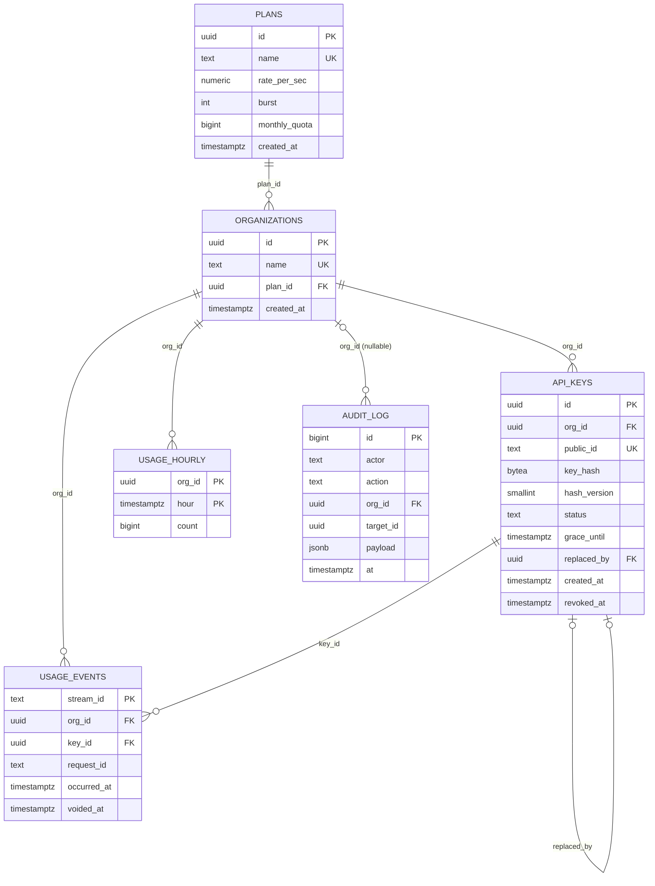

# DATABASE_DESIGN.md: Schema, constraints, indexing, retention, isolation

> Day 2 deliverable. Status date: 2026-11-20. This is a paper design; nothing is migrated yet (the first Alembic migration is Week 2 work). Postgres 15 is the **source of truth**; Redis holds derived, rebuildable state (section 7). Decision IDs refer to [DECISIONS.md](DECISIONS.md).

## 1. Relationship diagram



Reading the diagram: a **plan** has many **organizations**; an organization owns many **api_keys**, **usage_events**, and **usage_hourly** rows. A key can point to its replacement (rotation). `audit_log` rows optionally reference an organization.

## 2. Tables

### 2.1 `plans`
Plan limits are **data, not code**: adding a tier is an `INSERT`.

| Column | Type | Constraints | Notes |
|---|---|---|---|
| `id` | `uuid` | PK, default `gen_random_uuid()` | |
| `name` | `text` | NOT NULL, **UNIQUE** | e.g. `free`, `pro` |
| `rate_per_sec` | `numeric(10,3)` | NOT NULL, `CHECK (rate_per_sec > 0)` | token refill rate |
| `burst` | `integer` | NOT NULL, `CHECK (burst >= 1)` | bucket capacity |
| `monthly_quota` | `bigint` | NOT NULL, `CHECK (monthly_quota >= 0)` | |
| `created_at` | `timestamptz` | NOT NULL, default `now()` | |

### 2.2 `organizations`

| Column | Type | Constraints | Notes |
|---|---|---|---|
| `id` | `uuid` | PK | |
| `name` | `text` | NOT NULL, **UNIQUE** | |
| `plan_id` | `uuid` | NOT NULL, **FK -> plans(id) ON DELETE RESTRICT** | a plan in use cannot be deleted |
| `created_at` | `timestamptz` | NOT NULL, default `now()` | |

### 2.3 `api_keys`

| Column | Type | Constraints | Notes |
|---|---|---|---|
| `id` | `uuid` | PK | |
| `org_id` | `uuid` | NOT NULL, **FK -> organizations(id) ON DELETE RESTRICT** | |
| `public_id` | `text` | NOT NULL, **UNIQUE** | random, embedded in the key string; used to find the row |
| `key_hash` | `bytea` | NOT NULL, `CHECK (octet_length(key_hash) = 32)` | HMAC-SHA256 output; **there is no plaintext column anywhere** |
| `hash_version` | `smallint` | NOT NULL, default 1 | which pepper version produced `key_hash` (pepper rotation, T-12) |
| `status` | `text` | NOT NULL, `CHECK (status IN ('active','rotating_out','revoked'))` | |
| `grace_until` | `timestamptz` | NULL | end of the rotation window |
| `replaced_by` | `uuid` | NULL, **FK -> api_keys(id)** | the new key created by a rotation |
| `created_at` | `timestamptz` | NOT NULL, default `now()` | |
| `revoked_at` | `timestamptz` | NULL | |

Row-level checks:
- `CHECK (status <> 'rotating_out' OR grace_until IS NOT NULL)`
- `CHECK (status <> 'revoked' OR revoked_at IS NOT NULL)`

The 20-active-keys-per-org limit (Q-13) is enforced in the admin transaction under a lock on the organization row, not by a constraint.

### 2.4 `usage_events`
One row per **admitted** request (D-10). The primary key is the Redis stream id, which makes worker redelivery harmless.

| Column | Type | Constraints | Notes |
|---|---|---|---|
| `stream_id` | `text` | **PK** | e.g. `1732096800123-0` |
| `org_id` | `uuid` | NOT NULL, FK -> organizations(id) | |
| `key_id` | `uuid` | NOT NULL, FK -> api_keys(id) | |
| `request_id` | `text` | NULL | LB-assigned id; informational, **not unique** |
| `occurred_at` | `timestamptz` | NOT NULL | from Redis `TIME` at admission |
| `voided_at` | `timestamptz` | NULL | set when the request ended non-2xx |

### 2.5 `usage_hourly`
Pre-aggregated counts for fast reporting and for rebuilding Redis counters.

| Column | Type | Constraints | Notes |
|---|---|---|---|
| `org_id` | `uuid` | FK -> organizations(id) | |
| `hour` | `timestamptz` | NOT NULL, `CHECK (date_trunc('hour', hour) = hour)` | UTC hour start |
| `count` | `bigint` | NOT NULL, `CHECK (count >= 0)` | admitted and not voided |
| | | **PK (`org_id`, `hour`)** | |

### 2.6 `audit_log`
Admin actions only (create org, create key, rotate, revoke, plan change). Low volume.

| Column | Type | Constraints | Notes |
|---|---|---|---|
| `id` | `bigint` | PK, `GENERATED ALWAYS AS IDENTITY` | |
| `actor` | `text` | NOT NULL | `admin` (D-18) |
| `action` | `text` | NOT NULL | |
| `org_id` | `uuid` | NULL, FK -> organizations(id) | |
| `target_id` | `uuid` | NULL | key id, plan id, ... |
| `payload` | `jsonb` | NOT NULL, default `'{}'` | **never contains key secrets or hashes** |
| `at` | `timestamptz` | NOT NULL, default `now()` | |

The application role gets `INSERT` and `SELECT` only; no `UPDATE` or `DELETE` (append-only).

## 3. DDL sketch (illustrative, to be turned into an Alembic migration in Week 2)

```sql
CREATE TABLE plans (
  id            uuid PRIMARY KEY DEFAULT gen_random_uuid(),
  name          text NOT NULL UNIQUE,
  rate_per_sec  numeric(10,3) NOT NULL CHECK (rate_per_sec > 0),
  burst         integer NOT NULL CHECK (burst >= 1),
  monthly_quota bigint NOT NULL CHECK (monthly_quota >= 0),
  created_at    timestamptz NOT NULL DEFAULT now()
);

CREATE TABLE organizations (
  id         uuid PRIMARY KEY DEFAULT gen_random_uuid(),
  name       text NOT NULL UNIQUE,
  plan_id    uuid NOT NULL REFERENCES plans(id) ON DELETE RESTRICT,
  created_at timestamptz NOT NULL DEFAULT now()
);

CREATE TABLE api_keys (
  id          uuid PRIMARY KEY DEFAULT gen_random_uuid(),
  org_id      uuid NOT NULL REFERENCES organizations(id) ON DELETE RESTRICT,
  public_id   text NOT NULL UNIQUE,
  key_hash    bytea NOT NULL CHECK (octet_length(key_hash) = 32),
  hash_version smallint NOT NULL DEFAULT 1,
  status      text NOT NULL CHECK (status IN ('active','rotating_out','revoked')),
  grace_until timestamptz,
  replaced_by uuid REFERENCES api_keys(id),
  created_at  timestamptz NOT NULL DEFAULT now(),
  revoked_at  timestamptz,
  CHECK (status <> 'rotating_out' OR grace_until IS NOT NULL),
  CHECK (status <> 'revoked' OR revoked_at IS NOT NULL)
);
CREATE INDEX api_keys_org_status_idx ON api_keys (org_id, status);

CREATE TABLE usage_events (
  stream_id   text PRIMARY KEY,
  org_id      uuid NOT NULL REFERENCES organizations(id),
  key_id      uuid NOT NULL REFERENCES api_keys(id),
  request_id  text,
  occurred_at timestamptz NOT NULL,
  voided_at   timestamptz
);
CREATE INDEX usage_events_org_time_idx ON usage_events (org_id, occurred_at);
CREATE INDEX usage_events_time_idx     ON usage_events (occurred_at);

CREATE TABLE usage_hourly (
  org_id uuid NOT NULL REFERENCES organizations(id),
  hour   timestamptz NOT NULL CHECK (date_trunc('hour', hour) = hour),
  count  bigint NOT NULL CHECK (count >= 0),
  PRIMARY KEY (org_id, hour)
);

CREATE TABLE audit_log (
  id        bigint GENERATED ALWAYS AS IDENTITY PRIMARY KEY,
  actor     text NOT NULL,
  action    text NOT NULL,
  org_id    uuid REFERENCES organizations(id),
  target_id uuid,
  payload   jsonb NOT NULL DEFAULT '{}',
  at        timestamptz NOT NULL DEFAULT now()
);
CREATE INDEX audit_log_org_time_idx ON audit_log (org_id, at);
```

This DDL has **not** been executed against a database yet; it is validated only by reading. Running it on Postgres 15 is a Week 2 task.

## 4. Keys and constraints, explained

| Constraint | What it prevents |
|---|---|
| `plans.name` unique | two plans with the same name |
| `organizations.plan_id` FK, RESTRICT | deleting a plan that organizations use |
| `api_keys.public_id` unique | two keys that cannot be told apart at lookup |
| `key_hash` length 32 | storing a raw secret or a truncated hash by mistake |
| `status` check plus the two row checks | `rotating_out` without an end time; `revoked` without a time |
| `usage_events.stream_id` primary key | the same Redis event inserted twice (worker redelivery) |
| `usage_hourly (org_id, hour)` primary key | two rollup rows for one hour; enables upsert |
| `usage_hourly.count >= 0` | rollup going negative after void bugs |
| `audit_log` without UPDATE/DELETE grants | silent editing of history |

## 5. Indexing strategy

| Index | Query it serves |
|---|---|
| `api_keys(public_id)` unique | uniqueness at key creation, and the full load that fills Redis (the request path itself never queries it) |
| `api_keys(org_id, status)` | list or count an organization's active keys (admin, 20-key limit) |
| `usage_events(stream_id)` PK | worker idempotent insert; void lookup by admit id |
| `usage_events(org_id, occurred_at)` | audit and debugging for one organization over time |
| `usage_events(occurred_at)` | retention deletes of old rows in batches |
| `usage_hourly(org_id, hour)` PK | `GET /usage` range scan for one organization, already ordered by hour |
| `audit_log(org_id, at)` | operator history per organization |

No index on `usage_events.voided_at` or `request_id`: they are never searched on.

## 6. Usage rows and the rollup (how the two stay consistent)

The worker processes a batch in **one transaction** (D-10):

1. `INSERT INTO usage_events ... ON CONFLICT (stream_id) DO NOTHING RETURNING org_id, occurred_at`
2. For each row actually returned, `INSERT INTO usage_hourly ... ON CONFLICT (org_id, hour) DO UPDATE SET count = usage_hourly.count + 1`
3. For each `void` event: `UPDATE usage_events SET voided_at = ... WHERE stream_id = <admit_id> AND voided_at IS NULL RETURNING org_id, occurred_at`, then decrement the matching hour for each row returned.
4. `COMMIT`, then acknowledge the stream entries.

Because the rollup only changes for rows the insert or update actually touched, a redelivered batch changes nothing the second time. If the transaction rolls back, nothing was acknowledged and the batch is retried.

## 7. What lives in Redis instead (derived, rebuildable)

| Key | Content | Rebuilt from |
|---|---|---|
| `key:<public_id>` | org id, hash, hash version, status, grace end; **only usable keys** (`active`, `rotating_out`) | full load from `api_keys` at rebuild, then write-through on every admin change |
| `org:<id>` | plan limits | full load from `organizations` + `plans`, then write-through on plan change |
| `{org:<id>}:bucket` | token bucket state | not rebuilt; starts full |
| `{org:<id>}:q:<YYYYMM>` | monthly counter | `SUM(usage_hourly.count)` for that month |
| `{org:<id>}:req:<request_id>` | duplicate-request marker, TTL 60 s | not rebuilt |
| `usage:events` | stream of admit and void events | not rebuilt; drained by the worker |

(The spike scripts call the request-id marker `idem`; it is the same marker.)

## 8. Data retention and sizing

| Data | Retention | Mechanism |
|---|---|---|
| `usage_events` | 14 days | scheduled batched `DELETE ... WHERE occurred_at < now() - interval '14 days'` |
| `usage_hourly` | 13 months | scheduled `DELETE` of older hours |
| `audit_log` | kept (low volume) | none |
| revoked keys | kept | needed for history; the secret is never stored anyway |

Sizing, using the stated target (Q-25) and an **assumed** average load. Rows at roughly 100 bytes plus index overhead; these are estimates, not measurements.

| Table | Assumption | Rows | Rough size |
|---|---|---|---|
| `usage_events` | average 20 rps x 14 days | ~24 million | a few GB |
| `usage_events` | worst case 200 rps sustained x 14 days | ~242 million | tens of GB |
| `usage_hourly` | 1,000 orgs x 24 h x ~395 days | ~9.5 million | < 1 GB |

If sustained traffic approaches the worst case, switch `usage_events` to daily range partitions (drop a partition instead of deleting rows; the primary key then includes `occurred_at`). This is deliberately not done in v1 (simplicity); it is listed in DESIGN §22.

## 9. Organization-level data isolation (D-21)

- Every tenant-owned table carries `org_id` (`api_keys`, `usage_events`, `usage_hourly`, `audit_log`).
- All repository functions that read tenant data **require** an `org_id` argument.
- For a customer calling `GET /usage`, `org_id` comes from the authenticated key. There is no customer-supplied `org_id` parameter; only the admin token may pass one.
- A Redis miss on `key:<public_id>` means the key does not exist or is revoked, so the request is rejected without querying Postgres.
- Redis keys of one organization share the `{org:<id>}` hash tag, and the auth cache entry stores the `org_id` the key belongs to.
- Planned proof: `test_usage_isolation` creates two organizations with usage and asserts neither key can see the other's data, including with a forged `org_id` query parameter.
- Row-level security was considered and rejected (D-21): it needs per-request session variables on pooled connections and is harder to test.

## 10. Migration notes for Week 2

- Alembic migration 0001 creates the six tables and indexes above.
- A seed script inserts example plans (illustrative values in DESIGN §13).
- The application database role gets `INSERT`/`SELECT` on `audit_log` only; usage tables get `INSERT`/`UPDATE`/`DELETE` for the worker role.